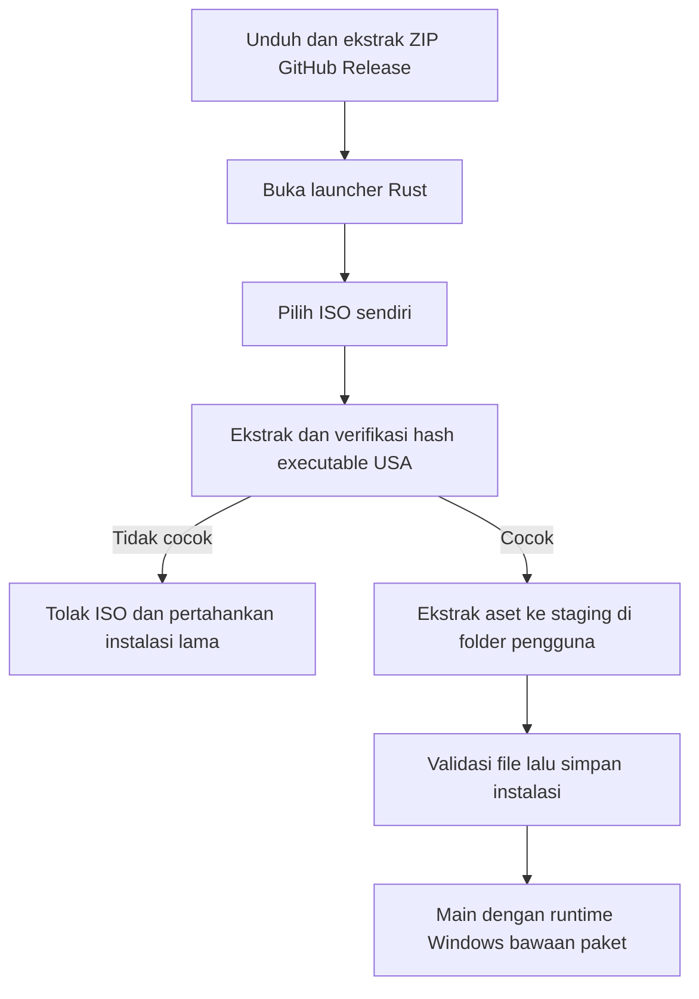
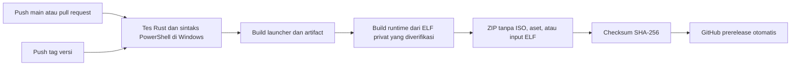

# Flow Windows: paket siap pakai

Keputusan pengguna: pengguna akhir cukup memilih ISO untuk mengambil aset;
compiler tidak diperlukan di PC pengguna. Runtime dibangun oleh pengembang/CI.

ISO tidak diunduh oleh launcher. Versi awal hanya mendukung USA `SLUS_212.15`.
Hash executable dan revision PS2Recomp berada di `config/game.json`. Aset dan
save berada di penyimpanan aplikasi pengguna, terpisah dari ZIP rilis. Mengganti
paket launcher/runtime tidak memerlukan impor ulang jika versi game sama.

## GitHub Actions

Workflow: `.github/workflows/windows.yml`.
- Push/PR: format, Clippy, unit tests, dan build launcher di `windows-2022`.
- Tag `v<versi Cargo.toml>`: setelah tes lulus, generate C++ dan build runtime;
  kemas launcher, runtime, DLL dan notices, lalu terbitkan prerelease otomatis.
- `workflow_dispatch`: membangun paket untuk pengujian tanpa menerbitkan release.
- Pull request tidak menjalankan job yang memakai input ELF privat.

## Pengaturan repository sekali saja

1. Upload **source project**, bukan folder workspace keseluruhan. `.gitignore`
   mengecualikan ISO, data game, analisis lokal, hasil generate dan build.
2. Sediakan file ELF pengembang `SLUS_212.15` melalui URL HTTPS privat yang dapat
   diunduh runner. Ini file executable PS2 sekitar 4,9 MB, bukan ISO 4+ GB.
3. Tambahkan repository Actions secret bernama `PRIVATE_GAME_ELF_URL` berisi URL
   tersebut. Jika URL memiliki masa berlaku, perbarui sebelum build berikutnya.
   File harus memiliki hash yang cocok; URL atau hash yang salah menggagalkan build.
4. Aktifkan Actions. Coba **Run workflow** pada branch tepercaya untuk menguji
   build bersih terlebih dahulu. Input ELF dihapus pada akhir script dan tidak
   ikut artifact/release. Tidak ada cache output game yang dibagikan ke PR.
5. Setelah artifact lolos uji Windows, samakan versi `launcher/Cargo.toml` dan
   tag, misalnya `v0.1.0`, lalu push tag. Job release akan menerbitkan paket otomatis.

Tidak perlu menyimpan ISO, ELF, atau kode C++ hasil generate di Git. `functions.csv`
adalah metadata nama/alamat fungsi; input kode game tetap disediakan privat saat build.
Build source lokal juga dapat menggunakan `scripts/Build-WindowsRuntime.ps1 -LocalElf <path>`
dengan ELF milik pengembang sendiri.

## Status dan batas saat ini

Launcher sudah memiliki impor ISO di background, validasi SHA-256, staging,
penyimpanan lokasi, dan pemanggilan runtime bawaan paket. Script build/packaging
serta workflow sudah ditulis. Pengujian lokal tidak menggantikan run GitHub Actions.
Repository belum dihubungkan ke GitHub, secret belum diisi, dan workflow belum
pernah dijalankan di GitHub.

Runtime Windows dapat dikompilasi, tetapi menu/gameplay belum terverifikasi.
Paket selalu ditandai **experimental/prerelease**. Jangan mengubahnya menjadi
rilis playable sampai cold boot, gameplay, audio, controller, save, dan main ulang
lolos pada perangkat Windows. Pengujian native macOS dihentikan atas arahan pengguna.
